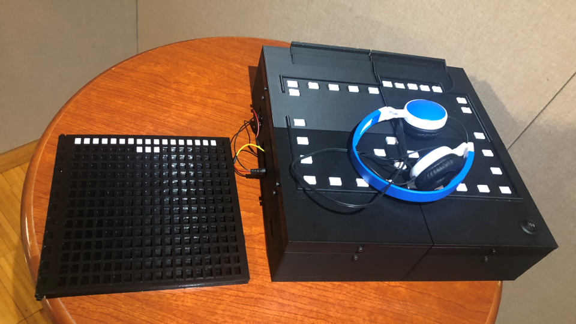
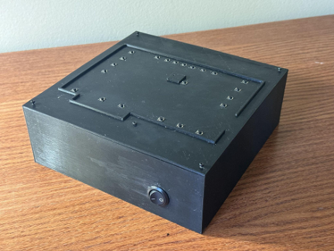
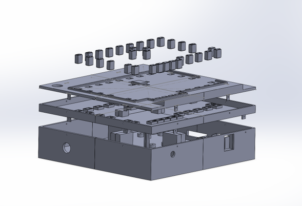
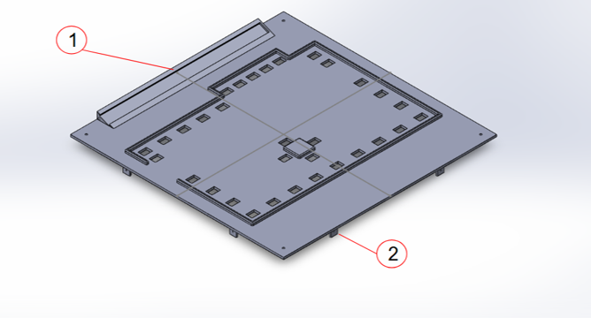
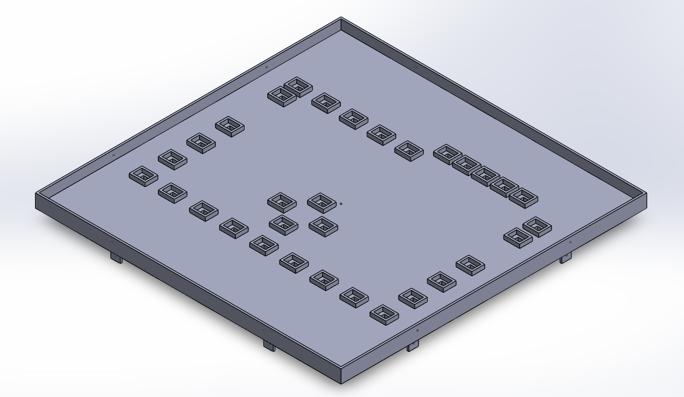
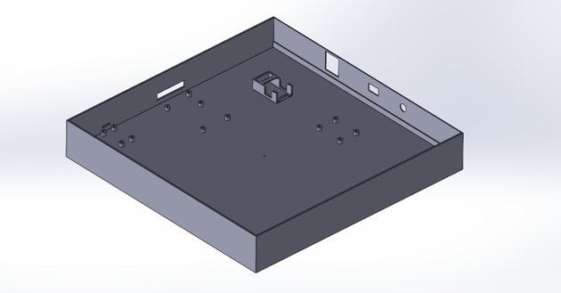
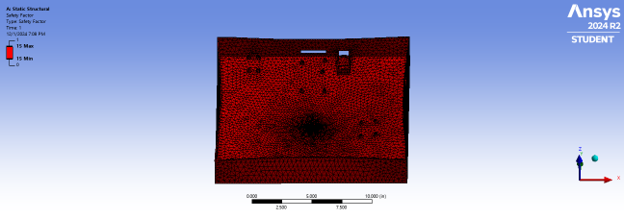
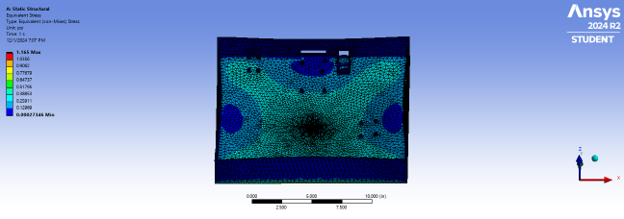
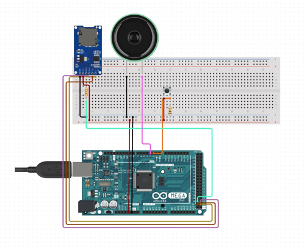

<div align="center">

# Audio-Tactile Map for the Gannett Art Gallery



### A Modular, Haptic-First Assistive Interface for Spatial Audio Navigation 

[](#)
[](#)
[](#)
[](#)

</div>

---

## At a Glance

| | |
|:---|:---|
| **System Function** | 32 tactile Braille buttons trigger location-aware audio descriptions of gallery artworks via embedded spatial mapping |
| **Target Population** | Blind and visually impaired museum visitors |
| **Deployment Site** | [Gannett Art Gallery](https://gannettgallery.org), SUNY Polytechnic Institute |
| **Validation Partner** | Central Association for Blind and Visually Impaired (CABVI) — user-centered design consultation and formative evaluation |
| **Embedded Platform** | Arduino MEGA 2560, TMRpcm audio engine, SPI SD storage |
| **Manufacturing** | Fused Deposition Modeling (FDM) 3D printing in PLA, modular quadrant architecture |
| **Unit Cost** | ~$170 USD |

<div align="center">

\
**Original Prototype — Proof-of-concept tactile interface**

</div>

## How It Works

```
┌─────────────┐     ┌─────────────┐     ┌─────────────────┐
│   TOUCH     │────▶│    MAP      │────▶│     HEAR        │
│             │     │             │     │                 │
│ Press a     │     │ Arduino     │     │ Pre-recorded    │
│ Braille     │     │ reads the   │     │ audio plays     │
│ button on   │     │ button pin  │     │ through speaker │
│ the gallery │     │ and pulls   │     │ or headphones   │
│ layout      │     │ .wav from   │     │                 │
│             │     │ SD card     │     │                 │
└─────────────┘     └─────────────┘     └─────────────────┘
```

---

## Motivation and Design Rationale

Museums are inherently visual institutions. Existing accessibility interventions frequently introduce secondary barriers:
- **Smartphone dependency** — creates cost and digital-literacy barriers for populations with limited access to assistive technology infrastructure
- **Audio-overload interfaces** — disrupt spatial memory formation and cognitive mapping through unstructured, non-spatial audio streams
- **Absence of tactile reference frames** — prevent visitors from constructing a coherent mental model of the gallery topology, a prerequisite for independent navigation

The Audio-Tactile Map (ATM) is a **standalone, haptic-first assistive device** grounded in the principles of universal design and spatial cognition. Visitors physically explore the gallery layout through embossed Braille topography, press a location-correspondent button, and receive a pre-recorded audio description — eliminating dependencies on external devices, network connectivity, or sighted assistance.

> *Developed through iterative design cycles in continuous consultation with CABVI to ensure ecological validity and real-world usability for the target population.*

---

## Empirical Validation and Real-World Impact

> *"The modular Braille blocks and clear audio quality make independent navigation possible. Moving the speaker to the front and adding adjustable audio speed would make this even stronger."*  
> **— CABVI Formative Evaluation Feedback, April 25, 2025**

The device was **deployed and evaluated live** at the Gannett Art Gallery alongside a refreshable Braille tablet companion system. CABVI evaluators assessed tactile discriminability, audio intelligibility, and cognitive mapping efficacy. The system is currently in active use for rotating exhibitions, with iterative improvements guided by ongoing user feedback.

---

## System Architecture

A **three-layer modular stack** — each layer subdivides into four quadrants to conform to standard 220 × 220 mm FDM build volumes, enabling distributed manufacturing without specialized equipment.

<div align="center">

\
**Exploded view of the three-layer modular CAD assembly**

</div>

| Layer | Functional Role | Key Design Features |
|-------|-----------------|---------------------|
| **Top** | Haptic interface | Gallery contour map, 32 removable Braille blocks with standardized pin geometry, interchangeable exhibition title plate |
| **Middle** | Actuation support | 32 momentary tactile switches, blanking plates for unused slots, M3 alignment tabs for layer registration |
| **Bottom** | Electronics chassis | Arduino MEGA 2560, SPI SD card reader, LM386 audio amplifier, speaker / 3.5 mm TRS headphone jack, battery compartment, structural load-bearing pillars |

**Materials:** PLA (structural), steel M3 socket-head fasteners  
**Overall Dimensions:** 12" × 12" × 3.5" (305 mm × 305 mm × 89 mm)  
**Audio Encoding:** 8-bit PCM, 16 kHz mono, `.wav` container

<div align="center">

\
**Top Plate — Tactile gallery topology**\
\
**Middle Plate — Switch mounting and alignment**\
\
**Bottom Plate — Electronics integration and structural load path**

</div>

## Engineering Analysis and Validation

<details>
<summary><b>🛠️ Mechanical — Structural Integrity and Safety Factor 15</b></summary>

The bottom load-bearing plate was analyzed under full distributed operational load using **ANSYS APDL and Workbench** finite-element methods:

| Metric | Value |
|--------|-------|
| Max deflection (center) | 1.17×10⁻⁴ in |
| Bending stress (center) | 0.504 psi |
| Von Mises stress | 0.589 psi |
| **Safety factor** | **15** |

Destructive mechanical validation was performed on an **Instron 33R4206** universal testing machine:
- **Tensile loading:** Failure occurred at >9,900 lbf
- **Compressive loading:** Plastic deformation initiated at **2,500 lbf**

> The ATM structural chassis withstands **>1,000×** its anticipated operational load envelope, ensuring durability under public-gallery use conditions including incidental impact and concentrated loads.

<div align="center">

\
**ANSYS Factor of Safety Distribution**\
\
**Von Mises Stress Contour Plot**\

</div>

</details>

<details>
<summary><b>⚡ Electrical — 32-Channel Direct-Mapped Input Architecture</b></summary>

All 32 buttons are wired directly to Arduino digital pins in `INPUT_PULLUP` configuration. A centralized solderable breadboard serves as a shared ground bus — eliminating 32 individual ground-return wires and reducing assembly time by approximately 40% while improving wiring reliability.

**Audio signal chain:** Arduino PWM (Digital Pin 11) → 3-position mode toggle → LM386 low-voltage audio amplifier → 8 Ω speaker or 3.5 mm TRS stereo headphone jack.

<div align="center">

\
**Electrical system wiring and component layout**\


</div>

</details>

<details>
<summary><b>💾 Firmware — TMRpcm Embedded Audio Engine</b></summary>

```cpp
#include "SD.h"
#include "TMRpcm.h"

#define SD_CS 53
TMRpcm tmrpcm;

void setup() {
  tmrpcm.speakerPin = 11;
  SD.begin(SD_CS);
  tmrpcm.setVolume(5);
  // 32 pins configured as INPUT_PULLUP...
}

void loop() {
  if (digitalRead(BUTTON_PIN2) == LOW) {
    tmrpcm.pause();
    tmrpcm.play("a.wav");   // Gallery position 'a'
  }
  // ... 31 additional slots
}
```

- **Non-blocking playback:** `pause()` prevents audio sample overlap and channel contention
- **Low-latency response:** <50 ms from tactile actuation to audio onset
- **Hot-swappable content:** Audio descriptions updated by exchanging the SD card — no firmware reflashing required

</details>

<details>
<summary><b>🎵 Audio Pipeline — PCM Encoding and Content Management</b></summary>

All audio tracks are batch-converted to TMRpcm-compatible PCM format:

```bash
ffmpeg -i input.mp3 -ar 16000 -ac 1 -c:a pcm_u8 output.wav
```

| Parameter | Requirement |
|-----------|-------------|
| Bit depth | 8-bit unsigned |
| Sample rate | 16,000 Hz |
| Channels | Mono |
| Format | `.wav` |

Files are named `a.wav` through `ff.wav`, mapped clockwise to Braille block positions on the gallery topology.

</details>

---

## Build It

### Bill of Materials

| Category | Part | Qty | ~Cost |
|----------|------|-----|-------|
| Brain | Arduino MEGA 2560 | 1 | $48 |
| Storage | Micro SD Card Reader (SPI) | 1 | $7 |
| Audio | LM386 Amplifier Module | 1 | $3.50 |
| Audio | 3.5mm TRS Breakout + Toggle Switch | 1 | $19 |
| Audio | 8Ω Speaker | 1 | $10 |
| Input | Tactile Push Buttons (12×12 mm) | 32 | $8 |
| Power | Solderable Breadboard + wiring | 1 | $8 |
| Structure | PLA Filament (Black, ~2 kg) | 2 | $42 |
| Structure | PLA Filament (White, Braille) | 1 | $21 |
| Hardware | M3×8 mm Socket Head Bolts | 50 | $5 |
| | | **Total** | **~$170** |

### Assembly Procedure

1. **Fabricate** 12 quadrant components (4 per layer) via FDM on an Ender 3 S1 Pro or equivalent 220 × 220 mm build-plate printer
2. **Wire** tactile buttons to the shared ground bus, routing individual signal lines to Arduino digital pins D2–D45
3. **Integrate** SPI SD card reader, LM386 amplifier (D11 PWM output), and power-management switch
4. **Assemble** layers using M3 fasteners, insert Braille blocks into standardized receptacles, load SD card with exhibition audio
5. **Validate** each button for <1 lbf actuation force and clean, non-distorted audio playback across all 32 channels

---


## Team and Contributions

| | |
|:---|:---|
| **Bao Do** | Electrical architecture, embedded firmware development, wiring integration, system testing, and CABVI liaison |
| **Edric Pham** | Top and middle layer CAD modeling, Braille block geometry design, technical drafting |
| **Cong Du Phan** | Bottom layer structural CAD, ANSYS finite-element analysis, mechanical validation and destructive testing |
| **Faculty Advisor** | Dr. D.K. Jones |
| **Community Partner** | [CABVI](https://www.cabvi.org) — User-centered design consultation, formative evaluation, and accessibility expertise |

---

## Acknowledgments

- **SUNY Academic Innovation Grants Program** — Project funding
- **SUNY Poly CGAM (Center for Global Advanced Manufacturing)** — Additive manufacturing resources and fabrication support
- **CCAVA Initiative** — Project framework and institutional commitment to accessibility in cultural heritage

---

<div align="center">

**[⬆ Back to Top](#audio-tactile-map-for-the-gannett-art-gallery)**

*Designed for accessibility. Open to collaboration and replication.*

</div>
